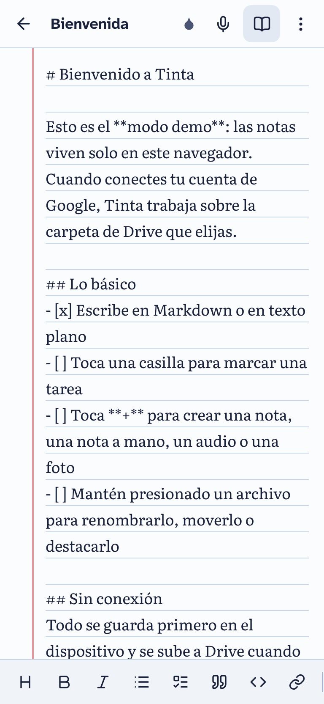
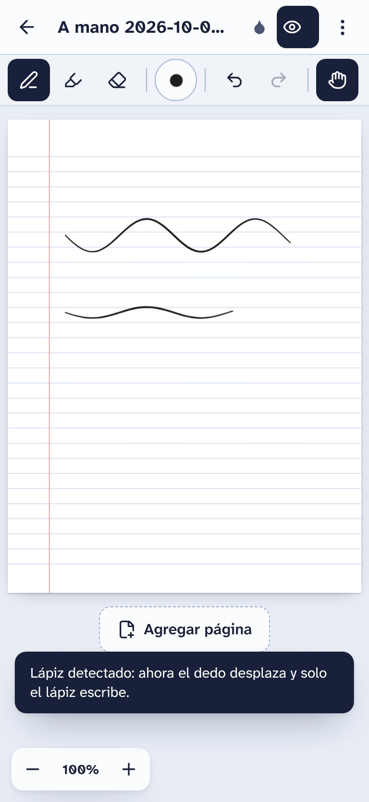
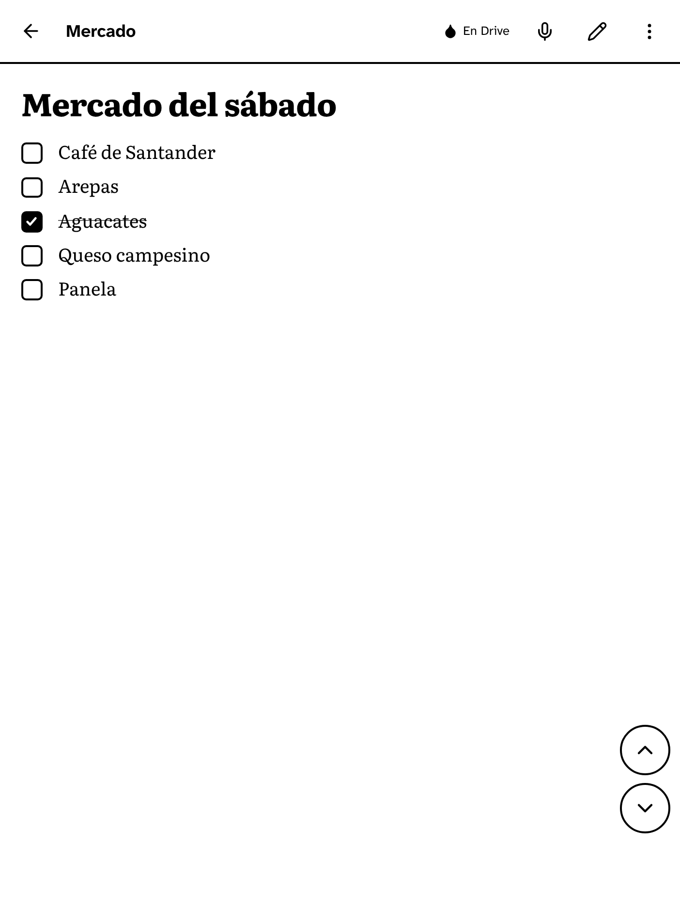
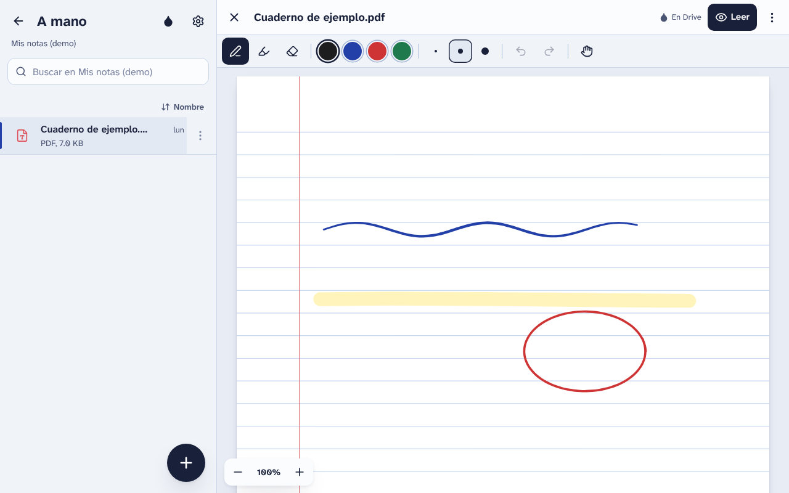

# Tinta

Notas, escritura a mano, audios, fotos y PDF guardados en **una carpeta de tu Google Drive** y sincronizados entre el teléfono, la tableta e-ink y el computador. Es una app web instalable (PWA): funciona sin conexión y se instala como app en Android y en Windows.

| Teléfono | A mano | Boox (modo e-ink) | Computador |
|---|---|---|---|
|  |  |  |  |

## Qué hace

- Muestra **todo** lo que hay en la carpeta que elijas (por ejemplo `🖋Notes`): subcarpetas, notas `.md` y `.txt`, imágenes, PDF, audios, videos y cualquier otro archivo.
- **Notas en Markdown** con títulos, listas que continúan solas, tareas con casillas, enlaces, fotos y audios dentro de la nota. Los `.txt` se editan como texto plano.
- **Escritura a mano** con presión del lápiz (S Pen, lápiz del Boox o mouse). Las notas a mano se guardan como **PDF**: se ven igual en Drive, en el lector del Boox o en cualquier visor, y en Tinta se siguen editando trazo por trazo.
- **Anotar PDF** existentes y **anotar o girar imágenes**.
- **Grabar audio** (nota de voz suelta o dentro de una nota) y **dictado por voz**.
- **Compartir a Tinta** desde cualquier app de Android (un PDF, una foto, un enlace, un texto) para guardarlo en la carpeta que elijas.
- **Sin conexión**: todo se guarda primero en el dispositivo y se sube a Drive cuando vuelve internet.
- **Modo e-ink** para el Boox: blanco y negro puro, sin animaciones, botones para pasar página y "solo lápiz" (la palma no raya).

### Qué se puede hacer con cada tipo de archivo

| Archivo | En Tinta |
|---|---|
| `.md`, `.markdown` | Editar y leer con formato; casillas, imágenes y audios embebidos |
| `.txt` y otros de texto (`.csv`, `.json`…) | Editar como texto plano |
| PDF | Leer, escribir y resaltar encima, agregar páginas a los cuadernos |
| Imágenes | Ver, anotar, girar |
| Audio y video | Reproducir |
| Documentos de Google (Docs, Sheets…) | Abrir en Drive |
| Cualquier otro | Renombrar, mover, destacar, descargar, abrir en Drive |

Todo se puede renombrar, mover a otra carpeta, destacar (es la "estrella" de Drive, así que se ve igual en Drive) y eliminar (va a la papelera de Drive, recuperable por 30 días).

## Puesta en marcha (unos 15 minutos)

Hacen falta dos cosas: **publicar la app** en una dirección `https://` y **crear un Client ID de Google** para que la app pueda entrar a tu Drive. No hay servidor: la app habla directo con Google desde tu navegador.

### 1. Publicar la app en GitHub Pages

1. Crea un repositorio en GitHub (por ejemplo `tinta`) y sube este código a la rama `main`.
2. En el repositorio: **Settings → Pages → Build and deployment → Source: GitHub Actions**.
3. Cada vez que hagas *push* a `main`, el flujo `.github/workflows/deploy.yml` corre las pruebas, compila y publica. La dirección queda así:
   `https://TU-USUARIO.github.io/tinta/`

> Cualquier hosting estático con HTTPS sirve igual (Azure Static Web Apps, Netlify, Cloudflare Pages). La app usa rutas relativas y navegación por `#`, así que no necesita reglas de reescritura. Lo único que importa es usar esa misma dirección en Google Cloud.

### 2. Crear el Client ID en Google Cloud

1. Entra a <https://console.cloud.google.com/> y crea un proyecto (por ejemplo "Tinta").
2. **APIs y servicios → Biblioteca** → busca **Google Drive API** → **Habilitar**.
3. **Google Auth Platform** (antes "Pantalla de consentimiento de OAuth") → **Comenzar**:
   - Nombre de la app: `Tinta`; correo de asistencia: el tuyo.
   - Público: **Externo**.
   - Datos de contacto: tu correo → **Crear**.
4. **Acceso a los datos → Agregar o quitar permisos** → agrega `https://www.googleapis.com/auth/drive` → **Guardar**.
5. **Público**: elige una de estas dos opciones.
   - **Publicar la app** (recomendado para uso personal). Google mostrará una vez la advertencia "Google no verificó esta app": toca **Configuración avanzada → Ir a Tinta**. Después no vuelve a preguntar.
   - O dejarla **en prueba** y agregarte en **Usuarios de prueba**. Funciona igual, pero Google exige volver a dar permiso **cada 7 días** (la app te muestra un botón para reconectar).
6. **Clientes → Crear cliente**:
   - Tipo: **Aplicación web**.
   - **Orígenes autorizados de JavaScript**: `https://TU-USUARIO.github.io`
   - **URI de redireccionamiento autorizados**: `https://TU-USUARIO.github.io/tinta/` (exacta, con la barra final)
   - **Crear** y copia el **ID de cliente** (termina en `.apps.googleusercontent.com`).
   - Para probar en tu computador agrega también `http://localhost:5173` (origen) y `http://localhost:5173/` (redirección).

Los cambios en Google Cloud pueden tardar unos minutos en aplicarse.

### 3. Darle el Client ID a la app

Cualquiera de estas opciones:

- **Variable de GitHub** (no queda en el código): en el repositorio, **Settings → Secrets and variables → Actions → Variables → New repository variable**, nombre `GOOGLE_CLIENT_ID`, y vuelve a publicar (Actions → "Publicar en GitHub Pages" → *Run workflow*).
- O edita `public/config.json`:
  ```json
  { "googleClientId": "123456-abc.apps.googleusercontent.com" }
  ```
- O pégalo en la pantalla de bienvenida de la app (se guarda solo en ese dispositivo).

### 4. Primer uso

Abre la dirección, toca **Conectar Google Drive**, elige tu cuenta y da permiso. Luego elige la carpeta de tus notas (puedes buscarla por nombre, por ejemplo `Notes`). La app lee el árbol completo y deja los textos disponibles sin conexión.

## Instalar en cada dispositivo

**Samsung Galaxy Z Fold (Android)**: abre la dirección en Chrome → menú **⋮ → Instalar app** (o "Agregar a la pantalla principal"). Abierto, el Fold muestra la lista y la nota lado a lado; cerrado, una pantalla a la vez.

**Onyx Boox Note2 (Android 9)**:
1. Activa Google Play en los ajustes del Boox si no lo has hecho e instala **Chrome** desde la Play Store. Úsalo en vez del navegador de Onyx, porque con navegadores integrados el inicio de sesión de Google puede fallar.
2. Abre la dirección en Chrome → **⋮ → Instalar app**.
3. En Tinta: **Ajustes → Modo e-ink**. "Solo el lápiz escribe" se activa solo la primera vez que usas el lápiz.
4. Para escribir a mano, usa el modo de refresco rápido del Boox (A2). La tinta se ve con algo de retraso comparada con la app de notas de Onyx: esa tinta instantánea solo existe para apps nativas hechas con el SDK de Onyx.
5. Chrome dejó de actualizarse en Android 9 (se quedó en la versión 138). Tinta está compilada para funcionar en esa versión.

**Windows**: abre la dirección en Edge o Chrome → ícono de instalar en la barra de direcciones. Puedes arrastrar archivos a la lista para subirlos y pegar capturas de pantalla dentro de una nota (Ctrl+V).

## Uso diario

- **+** crea: nota, nota a mano (papel rayado, cuadriculado, puntos o en blanco), audio, foto, subir archivos, carpeta, texto simple.
- **Mantén presionado** un archivo (o clic derecho, o **⋮**) para abrir, renombrar, mover, destacar, descargar, abrir en Drive o eliminar.
- **Buscar** encuentra por nombre y dentro del texto de las notas, sin importar tildes ("cafe" encuentra "Café"). En el computador, la tecla `/` enfoca la búsqueda.
- **Ordenar** por nombre o por recientes con el botón sobre la lista.
- En una nota: **📖/✏️** cambia entre leer y editar; el micrófono dicta (di "nueva línea", "nuevo párrafo" o "punto y aparte"); la barra de abajo da formato e inserta fotos y audios. Las fotos y audios de una nota se guardan en una subcarpeta `_adjuntos` junto a la nota. Ctrl+B, Ctrl+I y Ctrl+S funcionan en el teclado.
- En un PDF: **Anotar** muestra el lápiz, el resaltador y el borrador. El botón lateral del lápiz también borra. Deshacer y rehacer con los botones o Ctrl+Z / Ctrl+Y. Con dos dedos haces zoom; con Ctrl+rueda en el computador.
- **Compartir**: desde la galería, el lector del Boox o el navegador, **Compartir → Tinta** y elige la carpeta. Por ejemplo: escribes en las notas del Boox, exportas a PDF y lo compartes a Tinta para tenerlo en Drive.
- Accesos directos del ícono (mantener presionado el ícono de la app): nueva nota, nota a mano, grabar audio.

## Sincronización

- La **gota de tinta** arriba indica el estado: llena = todo está en Drive; hueca con un número = cambios esperando; roja = hay que reconectar o hubo un error. Tócala para ver el detalle y sincronizar.
- Los cambios se suben a los pocos segundos. Los de otros dispositivos llegan cada minuto mientras la app está abierta, y al volver a ella.
- Si la misma nota se edita en dos dispositivos, Tinta **junta los cambios** línea por línea. Si chocan en la misma línea, tu versión queda en una copia con "(conflicto fecha)" en el nombre, para que no se pierda nada. Con PDF, imágenes y audio siempre se guarda la copia.
- Si alguien borra en Drive un archivo que tenías editado sin subir, Tinta lo vuelve a crear.
- La sesión de Google dura una hora. Cuando vence, la app se reconecta sola con una redirección rápida (cuando no estás escribiendo). Tus cambios nunca dependen de eso: se guardan primero en el dispositivo.

## Privacidad y permisos

- La app pide el permiso de **Google Drive completo** porque debe ver y editar todo lo que hay en tu carpeta, incluidos los archivos creados por otras apps (el Boox, tu celular, Drive). El código solo trabaja dentro de la carpeta que elegiste.
- No hay servidor intermedio: el navegador habla directo con Google. El token dura una hora y se guarda solo en el dispositivo.
- Puedes quitarle el acceso cuando quieras en <https://myaccount.google.com/permissions>, o con **Ajustes → Cerrar sesión** (que además borra la copia local).

## Limitaciones conocidas

- Los documentos de Google (Docs, Sheets, Slides) se abren en Drive; Tinta no los edita.
- Si mueves una nota a otra carpeta, sus enlaces relativos a `_adjuntos` dejan de apuntar a la ruta exacta; la vista previa los busca por nombre para seguir mostrándolos.
- En el Boox la escritura a mano tiene la latencia normal de una app web en e-ink.
- El dictado necesita internet y el servicio de voz de Google en el dispositivo.

## Desarrollo

```bash
npm install
npm run dev          # http://localhost:5173 (para Google, registra ese origen en el cliente OAuth)
npm test             # pruebas unitarias: motor de sincronización, fusión, cliente de Drive, PDF
npm run build        # genera dist/
npx playwright install chromium   # una vez
npx playwright test  # pruebas de punta a punta (modo demo y Google simulado), teléfono y escritorio
```

Sin Client ID, el botón **Probar sin cuenta** abre un **modo demo** con un Drive simulado dentro del navegador.

Para seguir el desarrollo con Claude Code, el contexto completo está en [`CLAUDE.md`](CLAUDE.md), [`docs/ARQUITECTURA.md`](docs/ARQUITECTURA.md) y [`docs/DECISIONES.md`](docs/DECISIONES.md).

Estructura:

- `src/sync/SyncEngine.ts` — sincronización: feed de cambios de Drive, cola sin conexión, fusión de 3 vías (`merge.ts`) y copias de conflicto.
- `src/drive/GoogleDrive.ts` — cliente REST de Drive v3 (subidas multipart y reanudables, reintentos). `FakeDrive.ts` simula Drive para pruebas y modo demo.
- `src/auth/googleAuth.ts` — OAuth de Google por redirección, con renovación silenciosa.
- `src/db/db.ts` — base local en IndexedDB.
- `src/ink/` — modelo de trazos (perfect-freehand) y lectura/escritura de anotaciones `/Ink` en PDF (pdf-lib); `pdfjs.ts` carga pdf.js (versión *legacy*, compatible con Chrome 138).
- `src/ui/` — interfaz (React). `src/sw.ts` — service worker (sin conexión y "Compartir a Tinta").

Tipografías: [Atkinson Hyperlegible Next](https://www.brailleinstitute.org/freefont/) y [Literata](https://github.com/googlefonts/literata), ambas con licencia SIL Open Font License (ver `src/fonts/`).
